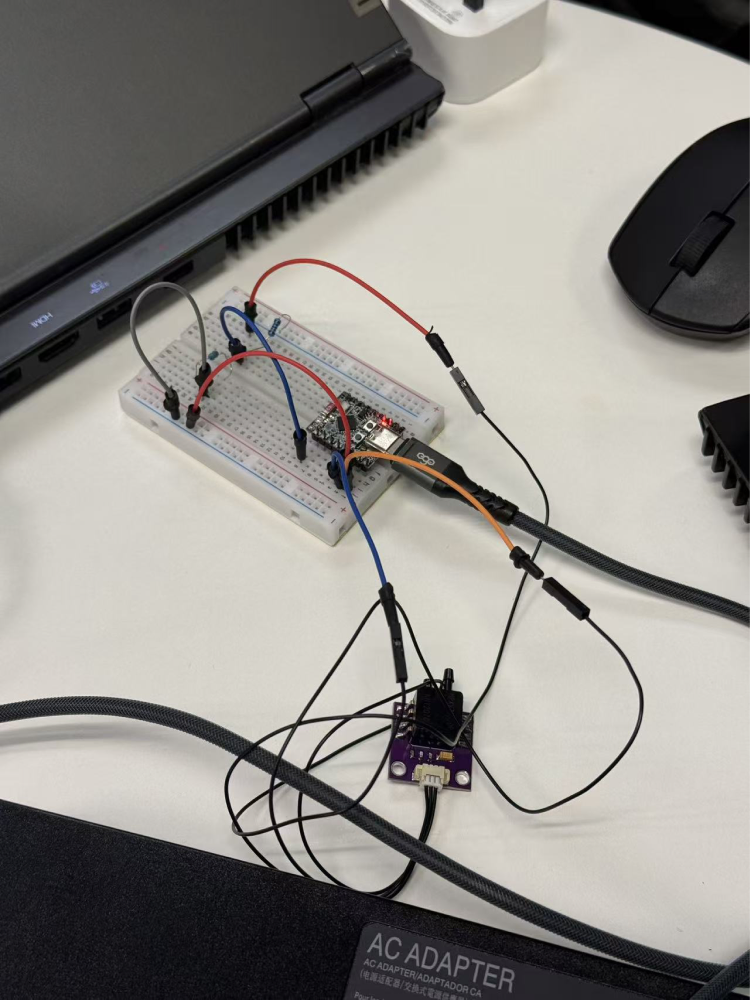
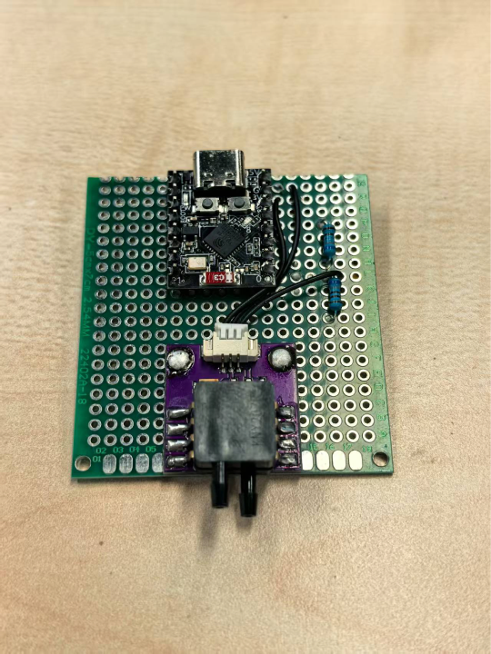

# WindSinger

*PolyU team project · September 2026 to present · Hardware research and design, hardware workstream lead and co-project manager*

WindSinger explores how a handheld breath-sensing device, a game and a companion app might make at-home breathing practice easier to follow and review. The device turns exhalation into an input signal for game feedback. The app is designed to record and display practice sessions. The project is an interaction prototype under development.

## My role

**Hardware research and design.** I investigated sensing and airflow options and worked with teammates on how tubing, sensor placement and the enclosure fit together. I reviewed shell dimensions, tubing connections and 3D-printing constraints with the hardware team. The sensor, enclosure, airway and fabrication work was shared among team members.

**Co-project management.** As the hardware lead and one of four co-PMs, I discussed prototype options and scope with the other leads, coordinated hardware handoffs, and joined debugging sessions with the game team. I helped prioritise a testable setup that could send a real breath signal to the game while the housing and air path were still being revised.

## What we learned

The first joint bench session surfaced unstable data and connectivity. After the hardware team adjusted electronics and the Bluetooth connection, the data issue did not recur in the second session. Tubing and shell fit still needed work. That distinction helped us separate what we had observed on the bench from what we still needed to verify on an assembled device.

The research team's clinician interviews highlighted difficulties with remembering practice and following the intended sequence and timing. These findings gave the team design questions to test, including whether players could understand the pacing cues and whether the session records would be easy to review.

## Hardware work photos

| Breadboard bench setup | Sensor and controller assembly |
| --- | --- |
|  |  |

Photos from the WindSinger hardware team’s working board.

## Research interest

At EARNEST, I would like to apply this approach to physical prototypes and community AI agents. One question I would like to explore with community members is when a prompt helps with an everyday routine, and when people would rather skip or change it. I would prototype a short interaction and observe how participants interpret and control the prompt.

[Back to the portfolio and CV](README.md)
